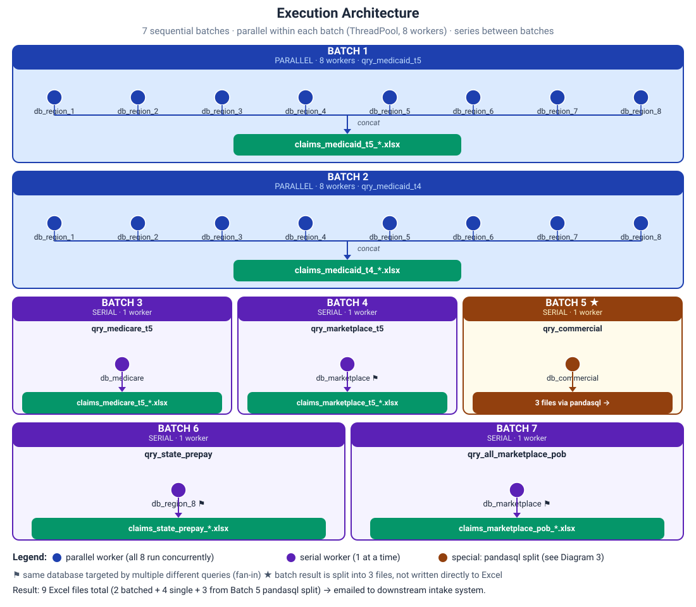
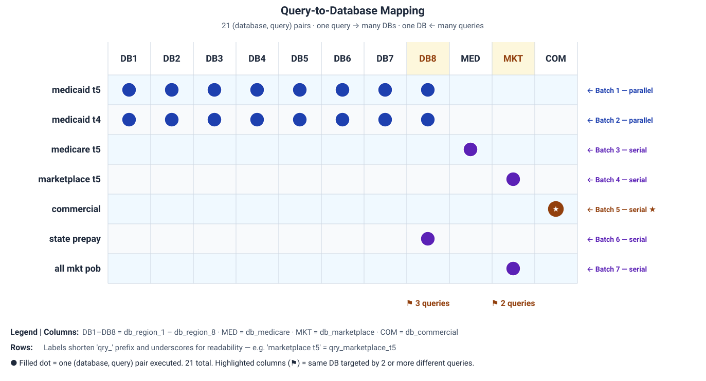
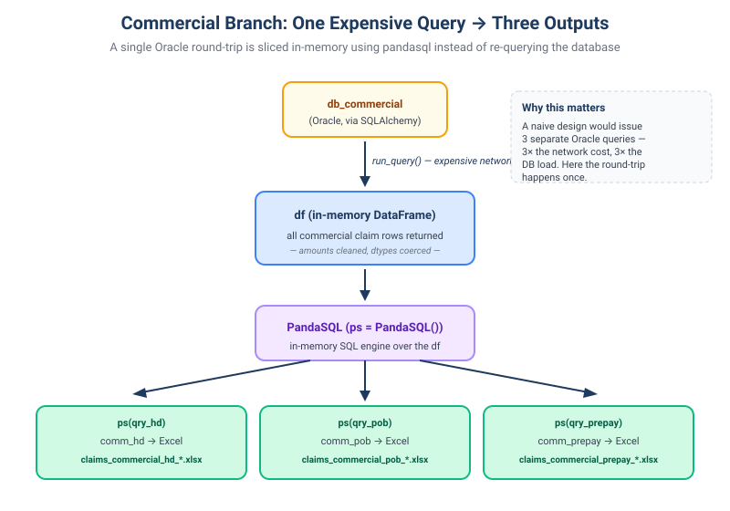

# Healthcare Claims ETL Pipeline (Multi-DB Fan-Out)

A reference Python notebook demonstrating an orchestration pattern for running multiple SQL queries against multiple Oracle databases, combining results in different ways per query, and distributing the outputs by email — all wrapped in resilient error handling so a single database outage doesn't break the run.

This repository shows the **Python orchestration layer only**. The SQL queries it invokes (`queries/*.py`) are intentionally not included; the notebook references them via Jupyter `%run` magic, and the value here is in how the orchestration is structured, not the query bodies themselves.

---

## What this demonstrates

- **Mixed parallel + serial execution** using `multiprocessing.pool.ThreadPool` and a list-of-lists batching scheme
- **Many-to-many mapping** between queries and databases (one query against many DBs, one DB hosting many queries) constructed cleanly with list multiplication and `zip`
- **Result-shape variability** handled per batch (some batches concatenate 8 dataframes into one Excel file; one batch sidesteps Excel entirely and uses **pandasql** to slice a single dataframe three ways)
- **Resilient execution** — five specific Oracle exception types caught with continue-on-error logging, so a regional DB failure doesn't kill the rest
- **Connection-lifecycle hygiene** — SQLAlchemy engines disposed after each query to keep the connection pool clean across 20+ executions

---

## The orchestration problem

There are **7 SQL queries** that need to run against **11 different databases** to produce **9 Excel files** for a downstream audit team. The mapping isn't symmetric:

- Two of the queries each need to run against the **same set of 8 regional databases** and the results from each query need to be **combined into one Excel file**.
- Four of the queries each run once against a **single specific database**.
- One query runs once against a single database but its result needs to be **sliced three different ways** (three different audit views) and written to three separate files.
- One database (`db_marketplace`) is targeted by **two different queries** at different points in the run.
- One database (`db_region_8`) is targeted by **three different queries** at different points in the run.
- Some queries are cheap; some hit cold partitions and take minutes. Doing everything serially would take far too long.

The pipeline solves this with three coordinated structures: a query list, a database list, and a list-of-lists that defines parallel batches.

---

## Execution architecture



**Parallel within a batch, serial between batches.**

A `ThreadPool` of 8 workers is created once. The main loop walks 7 batches in order. For each batch, `pool.map()` distributes the (database, query) pairs in that batch across the workers — so within batches 1 and 2, all 8 regional databases are queried concurrently; within batches 3–7, the single (db, query) pair runs on one worker.

Why series between batches? Two reasons:
1. **Database concurrency constraint.** The production database system enforces a one-concurrent-query-per-user-per-database limit — the same user account cannot run two queries against the same database simultaneously. The code is built to respect this: within any one batch, every (database, query) pair targets a *different* database, so a batch never asks one database to run two queries at once. A database that is used by more than one query (`db_region_8`, `db_marketplace`, and the eight regional databases across batches 1 and 2) only reappears in a *different* batch, and batches run one after another. The batch boundary is the design's way of respecting the per-user, per-database concurrency rule.
2. **Result aggregation is per-batch.** Each batch concatenates its dataframes (`pd.concat(global_ex_data)`) into a single output file. The accumulator (`global_ex_data`) is reset at the start of each batch iteration, so batches must complete in sequence.

---

## Query-to-database mapping



There are **21 (database, query) pairs** the pipeline runs. The matrix above shows them all: rows are queries, columns are databases, each filled dot is one execution.

Two visual patterns matter:

- **Horizontal rows of 8 dots** (rows 1–2) = parallel fan-out. The same query targets 8 databases concurrently; results stream back into one accumulator and get written to one Excel file.
- **Highlighted columns** (`db_region_8`, `db_marketplace`) = fan-in. The same database is targeted by multiple queries at different points in the schedule. The orchestration handles this naturally because the database name appears multiple times in the database list.

---

## The Commercial branch — a single query, three Excel files



Batch 5 is structurally different from every other batch. The Commercial query returns a full claims dataframe, but the downstream audit team needs that data sliced into **three separate views** (Headers, Paid-Over-Billed, and Prepay).

The naive approach would issue three separate Oracle queries — three network round-trips, three table scans, three sets of database load. Instead, the pipeline:

1. Runs the Oracle query **once** to populate one dataframe in memory.
2. Cleans the result (the `Processed Date` column is normalized in the main loop).
3. Hands the dataframe to **pandasql**, which exposes a SQLite-like SQL engine over pandas dataframes.
4. Runs three lightweight in-memory SQL queries (`qry_hd`, `qry_pob`, `qry_prepay`) against the same dataframe.
5. Writes each result to its own Excel file.

This is why the main loop has a conditional check `if zip_dest_query[i][0][0] == 'db_commercial'` — when it detects the Commercial batch, it skips the standard Excel write and hands off to the downstream pandasql cells instead. (A commented-out manual re-run cell in the notebook also shows amount-column dtype coercion for this branch.)

---

## How it's implemented

### 1. List multiplication to fan one query across many DBs

```python
query_list = (
    [qry_medicaid_t5] * len(region_dbs)   # 8 copies of medicaid_t5
    + [qry_medicaid_t4] * len(region_dbs) # 8 copies of medicaid_t4
    + [qry_medicare_t5, qry_marketplace_t5, qry_commercial,
       qry_state_prepay, qry_all_marketplace_pob]
)
```

The `[query] * N` trick replicates a query reference N times, lining it up with N databases in the parallel database list. Cheap, readable, no loops.

### 2. Database-list duplication to run a DB more than once

```python
db_list = (
    region_dbs * 2                       # 8 regional DBs, run twice (once for t5, once for t4)
    + ['db_medicare', 'db_marketplace',
       'db_commercial', 'db_region_8',   # ← db_region_8 reappears here
       'db_marketplace']                 # ← db_marketplace reappears here
)
```

The same database name appears multiple times in the list. When `zip()`'d against `query_list`, this produces (db, query) pairs that target the same database with different queries. No explicit coordination needed.

### 3. Zipping and batching

```python
zip_dest_query_orig = list(zip(db_list, query_list))                    # 21 (db, query) tuples
zip_dest_query = [zip_dest_query_orig[i:i + len(region_dbs)]            # first two slices of 8
                  for i in [0, len(region_dbs)]]
for i in range(len(region_dbs) * 2, len(query_list)):                   # remaining 5 as single-item batches
    zip_dest_query.append([zip_dest_query_orig[i]])
```

This produces a list of 7 batches. Batches 0–1 contain 8 pairs each (eligible for parallel execution); batches 2–6 contain 1 pair each. The same outer loop handles both shapes — `pool.map` over a list of 8 fans out 8 ways, `pool.map` over a list of 1 just runs once. No branching logic needed at the dispatch site.

### 4. The main loop

```python
pool = Pool(processes=8)
for i in range(len(zip_dest_query)):
    global_ex_data = []                                                 # per-batch accumulator
    pool.map(lambda each_query: run_query(each_query), zip_dest_query[i])

    if zip_dest_query[i][0][0] == 'db_commercial':
        # special path: hand off to pandasql cells downstream
        df = pd.concat(global_ex_data)
        # ... date cleanup ...
    else:
        # standard path: concat + write one Excel file
        df_dict[df_name] = pd.concat(global_ex_data)
        write_to_excel(df_dict[df_name], writer_list[i], header_nlist[i])
```

The `header_nlist` parallel structure provides the right column header list for each batch's output, since output schemas vary between batches.

### 5. The pandasql split (Commercial branch only)

```python
ps = PandaSQL()
comm_hd     = ps(qry_hd)        # in-memory SQL on the commercial dataframe
comm_pob    = ps(qry_pob)
comm_prepay = ps(qry_prepay)

write_to_excel(comm_hd,     'claims_commercial_hd_'     + now + '.xlsx', ...)
write_to_excel(comm_pob,    'claims_commercial_pob_'    + now + '.xlsx', ...)
write_to_excel(comm_prepay, 'claims_commercial_prepay_' + now + '.xlsx', ...)
```

`PandaSQL()` is instantiated **once** and reused — the original implementation called `pandasql.sqldf(query)` three times, which creates a new in-memory SQLite database per call. Reusing one `PandaSQL` instance is materially faster on a dataframe of this size.

---

## Email distribution and output formatting

After all Excel files are produced, the pipeline loops through them and sends each as an email attachment to a downstream data intake system that automatically ingests the files on receipt.

This is why output formatting is as precise as it is. Both the email and the spreadsheets must conform to the intake system's ingestion requirements — specific column headers (hence the per-batch `header_nlist` rather than default dataframe column names), specific sheet names, specific numeric formatting (`float_format="%.2f"`), and a specific email title and message body. A file that is structurally correct but uses the wrong header names, or an email with the wrong subject line, will not be picked up by the automated system.

The `header_nlist` parallel structure — one header list per batch, indexed to match `writer_list` — is a direct consequence of this constraint. Different query types return different schemas, and each schema has to map to the exact column names the intake system expects.

---

## Constraints and creative workarounds

| Constraint | Workaround |
|---|---|
| One query needs to run against 8 DBs and the 8 results need to land in one file | List multiplication (`[query] * 8`) + `pd.concat(global_ex_data)` inside the per-batch accumulator |
| Same DB needs to be queried multiple times with different queries | DB name appears multiple times in `db_list`; `zip()` produces the right pairs automatically |
| Some batches are parallel-eligible (8 DBs, same query), others must run alone | List-of-lists structure: inner list length determines parallelism. `pool.map` works the same on either |
| Output schema varies by batch | Parallel `header_nlist` indexed by batch number; passed to `write_to_excel` per batch |
| One DB's results need to be split three ways without re-querying | Single Oracle round-trip + `PandaSQL` instance reused across three in-memory SQL queries |
| One DB outage shouldn't kill the whole run | `try/except` around `run_query` catches `OperationalError`, `InternalError`, `ProgrammingError`, `NotSupportedError`, `DatabaseError`, and bare `Exception` — each path logs and `pass`es so the loop continues |
| 20+ Oracle connections opened over a run could exhaust the pool | `engine.dispose()` called after each query inside `get_readsql()` |
| Output files and emails must meet strict intake system formatting requirements | Per-batch `header_nlist` overrides default dataframe column names; `sheet_name`, `float_format`, email title, and message body are all hardcoded to match intake system expectations |

---

## Error handling

`run_query()` wraps every database call in a layered `try/except`:

```python
try:
    temp_df = get_readsql(dest=query[0], sql_query=query[1])
    global_ex_data.append(temp_df)
except OperationalError as e:    # connectivity / auth
    log_and_continue(...)
except InternalError as e:       # Oracle internal
    log_and_continue(...)
except ProgrammingError as e:    # SQL syntax / object missing
    log_and_continue(...)
except NotSupportedError as e:
    log_and_continue(...)
except DatabaseError as e:       # catch-all Oracle
    log_and_continue(...)
except Exception as e:           # absolute backstop
    log_and_continue(...)
```

Each handler logs the database name and the error message, then `pass`es. (`log_and_continue(...)` here stands for the print and logging calls in the notebook.) The threadpool moves on; the batch's accumulator simply has one fewer dataframe than it might have had. The downstream `pd.concat` works with whatever did succeed, and the Excel file is written with partial data plus a log entry showing which DB(s) failed.

> Note: the notebook's import cell imports only `DatabaseError` from `oracledb`. The other four exception classes must also be imported (for example from `oracledb`) for those handlers to be evaluated when an error occurs.

---

## Repository contents

```
healthcare-claims-etl-python/
├── README.md                          ← this file
├── claims_etl_pipeline.ipynb          ← the orchestration notebook
├── docs/
│   ├── execution-flow.svg
│   ├── query-db-matrix.svg
│   └── commercial-fanout.svg
└── queries/                           ← intentionally empty in this repo
    └── (SQL extract definitions live here in deployment)
```

The notebook is self-documenting — each major step has a markdown cell above it describing what the next code cell does and why. The `%run queries/*.py` magic loads query strings into local variables; in a working deployment those `.py` files each assign one SQL string to a named module-level variable (e.g., `qry_medicaid_t5 = """SELECT ... FROM ..."""`).

---

## Tech stack

- Python 3.10+
- `pandas`, `sqlalchemy`, `oracledb`, `pandasql`, `openpyxl`
- `multiprocessing.pool.ThreadPool` for I/O-bound concurrency (see design rationale below)
- Jupyter notebook as the orchestration runtime; could be lifted to a `.py` script with minimal refactoring

---

## Concurrency design rationale: why ThreadPool, and why it helps here

This is worth spelling out because the choice between threading and multiprocessing is a common point of confusion in Python, and the answer depends on what the workers are actually doing.

### The GIL and why it matters

Python's Global Interpreter Lock (GIL) prevents more than one thread from executing Python bytecode at the same time. This means that for CPU-bound work — parsing, computing, transforming data — Python threads do not run in true parallel. A `ThreadPool` on a CPU-bound task would actually be *slower* than running serially, because of the overhead of context-switching between threads that can't execute simultaneously anyway. For CPU-bound parallelism you need `ProcessPool`, which spawns separate Python processes each with their own GIL.

### Why this workload is different

Each call to `get_readsql()` does the following:

1. Opens a SQLAlchemy / `oracledb` connection
2. Sends the SQL string to the Oracle server over the network
3. **Waits** — potentially for minutes — while Oracle executes the query remotely
4. Reads the result rows back over the network into a pandas DataFrame

Steps 3 and 4 are network I/O. During a blocking I/O operation, the GIL is released — Python explicitly yields it while waiting for the OS to return data from the network socket. This means other threads are free to execute while any given thread is waiting on Oracle. In practice, all 8 threads send their queries nearly simultaneously, then each waits independently for its own database to respond. Wall-clock time for a batch of 8 = roughly the time of the slowest single query, not the sum of all 8.

In one production run, queries completed out of order (1.32 min, 1.37 min, 1.38 min, 3.65 min, 6.52 min) — the signature of genuine parallel I/O. They all started at the same time and finished whenever Oracle was done with each one. (Notebook cell outputs are not saved in this repository, so these timings are not reproduced here.)

### Why not ProcessPool

`ProcessPool` spawns separate OS processes, each with its own Python interpreter and memory space. This genuinely sidesteps the GIL for CPU-bound work. But it introduces two costs that make it the wrong choice here:

1. **Inter-process data transfer.** Each subprocess would need to serialize its DataFrame (via pickle) and send it back to the main process through a pipe. For large query results this is expensive and partially cancels the parallelism benefit.
2. **Process spawn overhead.** Spawning 8 processes has meaningful startup cost. For a workload where each task takes 1–6 minutes of waiting, this overhead is small — but `ThreadPool` carries none of it, since threads share the same process memory and start instantly.

Since the workers spend nearly all their time waiting on network I/O (not executing Python), `ThreadPool` gives the same concurrency benefit as `ProcessPool` would, with none of the serialization or spawn cost. The DataFrames accumulate directly in `global_ex_data` (shared memory) without any pickling or IPC.

### Summary

| | ThreadPool | ProcessPool |
|---|---|---|
| GIL bypassed? | No — but GIL releases during I/O | Yes — separate processes |
| True parallel for CPU work? | No | Yes |
| True parallel for I/O wait? | **Yes** — GIL released while waiting | Yes |
| DataFrame result transfer | Shared memory, zero cost | Pickle + IPC pipe, non-trivial |
| Right choice here? | **Yes** | No — adds cost, no benefit |

The decision rule: if your workers spend most of their time waiting for network or disk I/O, use `ThreadPool`. If they spend most of their time executing Python (parsing, computing, transforming), use `ProcessPool`.
